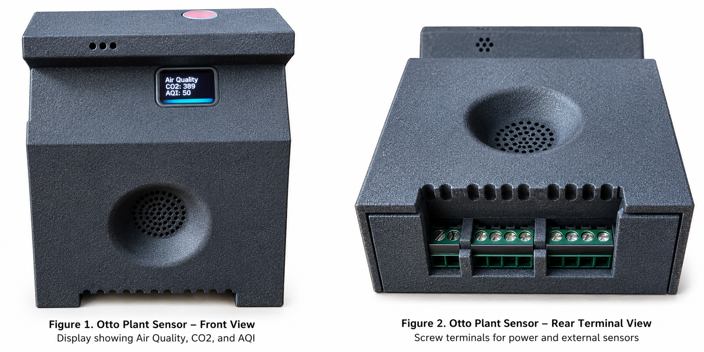
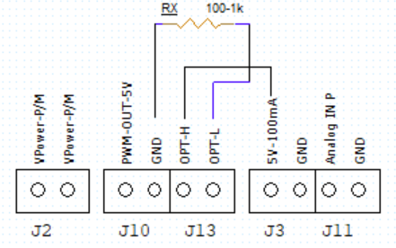
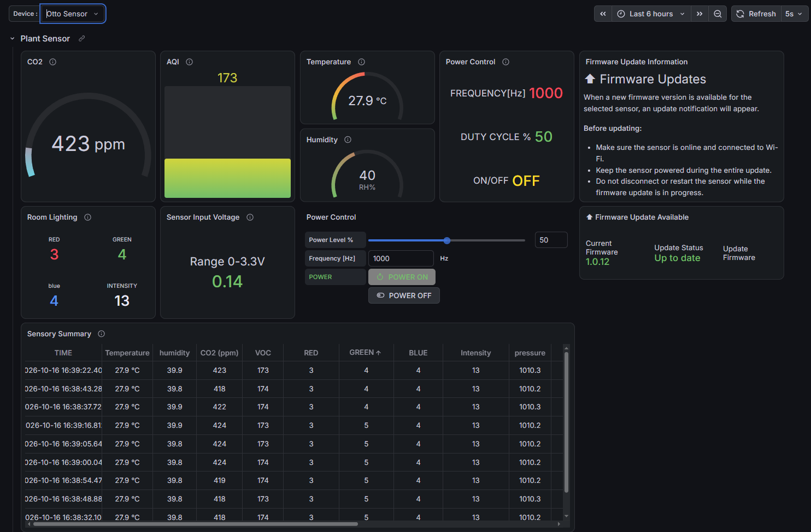
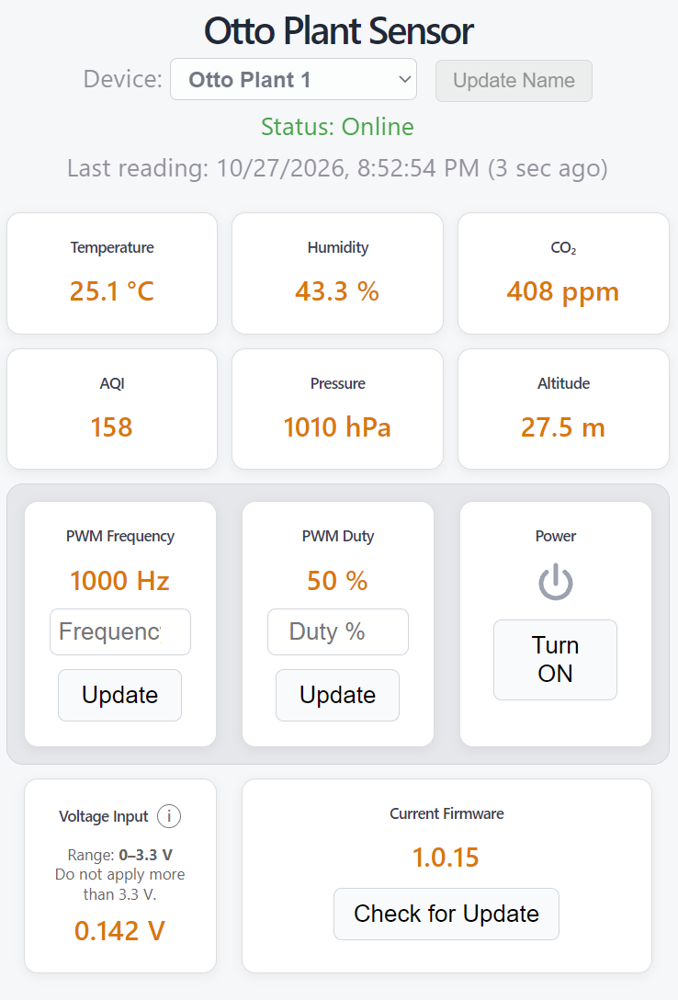
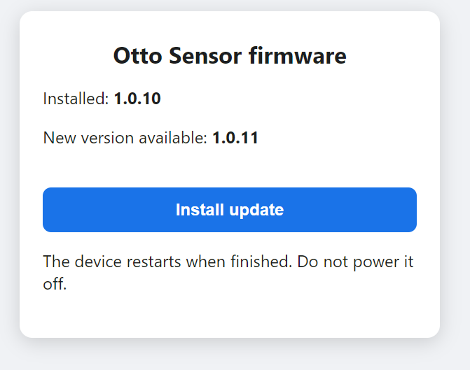
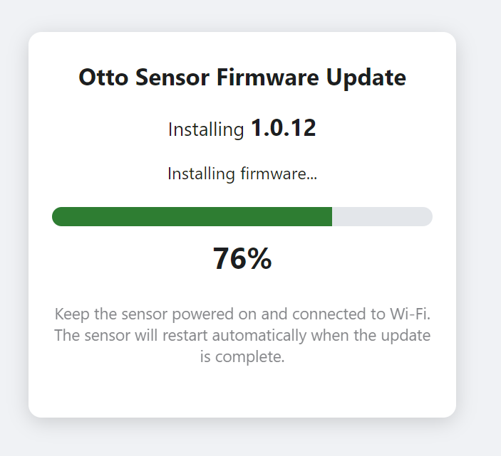
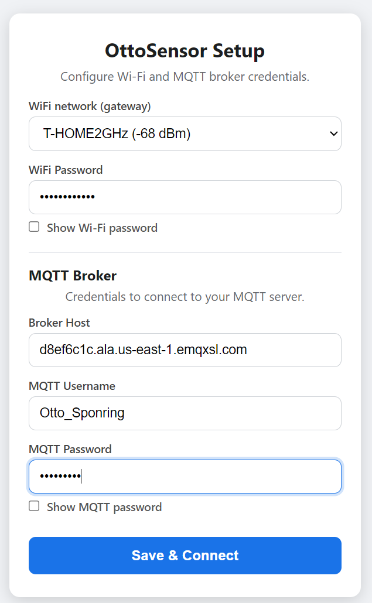

**Otto Plant Sensor**

**AWS Developer Deployment Manual**

From connected device to secure cloud telemetry, database, web
dashboard, control, and OTA

| **Purpose.** This manual is for developers building Wi‑Fi/MQTT devices similar to the Otto Plant Sensor. It translates the proven EMQX/Grafana operating model into an AWS-centered deployment path using AWS IoT Core, Lambda, API Gateway, Amplify, and a self-managed PostgreSQL database. It emphasizes device isolation, transparent data ownership, incremental deployment, and an architecture that can be debugged one layer at a time. |
|----|

Reference hardware from the original Otto Plant Sensor guide: front and
rear views with terminal interface.

*Draft 1.0 \| October 2026*

# 1. Audience and Design Goal

The original user/network guide describes a device that joins 2.4 GHz
Wi‑Fi, publishes telemetry and state through MQTT, receives
device-specific commands, stores historical data, exposes a dashboard,
and supports local OTA firmware installation. Those behaviors form the
functional contract for the AWS implementation.

| **Core design principle.** Keep the device protocol simple and stable; move cloud integration, storage, naming, dashboards, and operational logic into independently replaceable services. |
|----|

## 1.1 What a developer should be able to reproduce

- Provision a unique device identity and secure MQTT connection.

- Publish telemetry and state on device-specific topics.

- Route MQTT messages into a durable SQL database.

- Expose a small API for device discovery, current state, friendly
  names, and commands.

- Host a responsive web dashboard without embedding cloud credentials in
  the browser.

- Send commands back to exactly one selected device.

- Support firmware-version reporting and a safe OTA workflow.

- Troubleshoot each layer independently: device, MQTT, routing,
  database, API, and UI.

## 1.2 Why this architecture

| **Goal** | **AWS + self-managed PostgreSQL approach** |
|----|----|
| Device security | AWS IoT Core provides TLS device connectivity, policies, and topic-level authorization. |
| Data ownership | Telemetry is stored in PostgreSQL you administer, with ordinary SQL access and backup choices. |
| Loose coupling | MQTT ingestion, persistence, API, and UI are separate layers with clear interfaces. |
| Replaceability | The dashboard or database can evolve without changing the device MQTT contract. |
| Operational clarity | Each hop can be tested independently, reducing the blast radius of changes. |
| Cost control | Serverless ingestion/API components can scale with traffic while the database remains under direct control. |

# 2. Reference Architecture

The recommended production path is:

**Sensor → Wi‑Fi → AWS IoT Core → IoT Rule → Lambda → PostgreSQL → API
Gateway/Lambda → React Dashboard**

The command path runs in the opposite direction:

**Dashboard → API Gateway → Command Lambda → AWS IoT Core →
device/\<ID\>/command → Selected Sensor**

| **Layer** | **Recommended tool** | **Responsibility** |
|----|----|----|
| Device | ESP32-class MCU / embedded firmware | Sensors, local control, MQTT client, OTA, device identity. |
| Connectivity | 2.4 GHz Wi‑Fi + MQTT over TLS | Network path and encrypted device messaging. |
| Broker | AWS IoT Core | Authenticated MQTT, topic routing, device-specific publish/subscribe. |
| Ingestion | AWS IoT Rule | Match telemetry/state topics and invoke downstream processing. |
| Processing | AWS Lambda | Validate/normalize messages and write to SQL. |
| Database | Self-managed PostgreSQL on EC2 | Telemetry history, current device state, friendly names, audit-friendly SQL. |
| API | API Gateway + Lambda | Browser-safe read/write interface; hides DB and IoT credentials. |
| Web UI | React/Vite + AWS Amplify Hosting | Responsive dashboard, device selection, controls, firmware status. |
| Release | Git + firmware release storage | Versioned source, repeatable web builds, auditable firmware artifacts. |

| **Device isolation.** Use a unique MQTT client ID and a device-specific command topic. A command for one sensor must never be interpreted as a broadcast command. |
|----|

# 3. Translating the EMQX/Grafana Model to AWS

The EMQX-based guide provides a useful behavioral reference: MQTT over
TLS, separate telemetry/state/command topics, historical storage, a
selected-device dashboard, and OTA metadata. The AWS implementation
keeps those behaviors while changing the infrastructure behind them.

| **Reference guide concept** | **AWS-centered equivalent** | **What stays the same** |
|----|----|----|
| EMQX MQTT Broker | AWS IoT Core | MQTT/TLS, unique client identity, device-specific topics. |
| EMQX Tables | PostgreSQL on EC2 | Durable telemetry/state history queried by device identity. |
| Grafana dashboard | React dashboard on Amplify | Device selector, readings, controls, firmware status. |
| EMQX publish API / MQTT | API Gateway + Lambda + IoT publish | Browser sends a command; cloud publishes to one device topic. |
| EMQX device registry behavior | PostgreSQL device_state + friendly-name field | Physical identity remains stable while display name can change. |
| Local OTA page | Local OTA page retained | User confirms firmware install on the sensor; power/Wi‑Fi must remain stable. |

Legacy reference dashboard (Grafana/EMQX). Included for architectural
contrast with the AWS-hosted React dashboard shown below.

The legacy Grafana screen is retained only to show the migration path.
The current AWS implementation uses a purpose-built React web interface
hosted on AWS Amplify, while AWS IoT Core, Lambda, API Gateway, and
PostgreSQL provide the device messaging, processing, API, and
persistence layers.

Current AWS web dashboard. The React interface provides device
selection, online status, environmental telemetry, PWM and power
controls, input voltage, and firmware status in a responsive
desktop/mobile layout.

## 3.1 Dashboard migration at a glance

| Area | Legacy EMQX/Grafana | Current AWS implementation |
|----|----|----|
| Presentation | Grafana panels and variables | Purpose-built React/Vite dashboard |
| Hosting | Grafana service | AWS Amplify static hosting over HTTPS |
| Device selection | Grafana device variable | Friendly-name selector backed by API/database |
| Controls | Grafana/EMQX publish path | React → API Gateway/Lambda → AWS IoT Core |
| Data display | Queries against EMQX Tables | API reads self-managed PostgreSQL |
| Mobile behavior | Grafana responsive panels | Custom CSS/media rules tuned for phone use |

# 4. Device MQTT Contract

Treat the MQTT topic and payload contract as the most stable interface
in the system. Cloud components can be replaced later if the device
continues to publish and subscribe predictably.

## 4.1 Recommended topic pattern

| **Purpose**  | **Pattern**                              | **Direction**  |
|--------------|------------------------------------------|----------------|
| Telemetry    | ottosensors/device/\<DEVICE-ID\>/update  | Device → cloud |
| Device state | ottosensors/device/\<DEVICE-ID\>/state   | Device → cloud |
| Commands     | ottosensors/device/\<DEVICE-ID\>/command | Cloud → device |

The reference guide used the same separation of telemetry, state, and
command channels. For a new product, choose one naming convention early
and avoid silently changing it after devices are deployed.

## 4.2 Payload guidance

- Include a stable device identifier in the topic and, when useful, in
  the payload.

- Include firmware version in state messages so the cloud does not have
  to infer it.

- Keep telemetry numeric and machine-readable; perform display
  formatting in the UI.

- Add timestamps at the device when clock quality is reliable; otherwise
  record server receive time as well.

- For commands, make each field optional when independent controls
  should be updated independently.

- Validate ranges at both the browser/API boundary and in firmware.

# 5. AWS Deployment Path

Deploy in layers. Do not build the dashboard first and hope the device
path works later.

**Step 1 — Device connectivity.** Connect one device to Wi‑Fi and AWS
IoT Core. Verify TLS, unique client ID, telemetry publish, state
publish, and command subscription.

**Step 2 — IoT topic verification.** Use the AWS IoT MQTT test client to
observe the exact telemetry/state topics and publish a harmless command
to the selected device.

**Step 3 — IoT Rule.** Create a rule matching the telemetry topic family
and invoke a Lambda function. Keep the rule simple; avoid transforming
away fields you may need later.

**Step 4 — PostgreSQL.** Create telemetry and device-state tables on a
self-managed PostgreSQL instance. Restrict network access and use a
dedicated application role.

**Step 5 — State/telemetry Lambda.** Parse the MQTT event, validate it,
and UPSERT current device state while appending historical telemetry as
appropriate.

**Step 6 — Read API.** Expose device list and selected-device data
through API Gateway + Lambda. Test it directly before connecting React.

**Step 7 — Command API.** Accept browser commands server-side, validate
the selected device and values, then publish to AWS IoT Core.

**Step 8 — React dashboard.** Build device selection, readings, online
status, controls, friendly-name editing, and firmware status against the
API.

**Step 9 — Amplify Hosting.** Build the Vite application, deploy the
dist contents, configure allowed API origins, and test from a second
network/mobile device.

**Step 10 — OTA and recovery.** Verify version reporting, update
availability, local OTA reachability, successful restart, and the return
of a fresh post-update state.

| **Deployment discipline.** At every step, preserve the last known-good layer. If telemetry is already proven, do not modify the IoT Rule while debugging a web-layout issue. |
|----|

# 6. Self-Managed PostgreSQL

A self-managed database is a deliberate choice when developers want
direct SQL access, predictable schema control, straightforward exports,
and freedom to connect other analytics tools later. It also creates
operational responsibilities that managed database services would
otherwise absorb.

## 6.1 Suggested logical model

| **Table** | **Role** | **Typical fields** |
|----|----|----|
| telemetry | Append-only measurements | time, imei/device_id, temperature, humidity, CO₂, AQI, pressure, altitude, voltage, PWM values |
| device_state | Latest known state per device | device_id, power, firmware version, OTA metadata, last_seen, device_name |
| command_log (optional) | Audit of requested controls | time, device_id, command type, requested value, result/status |

## 6.2 Benefits

- Ordinary SQL access for debugging and reporting.

- Schema and retention policies remain under your control.

- Easy integration with Python, BI tools, Grafana, or future services.

- Friendly device names and operational metadata can live independently
  of immutable hardware identity.

- Cloud ingestion can be replaced without migrating the device protocol.

## 6.3 Responsibilities

- Patch the operating system and PostgreSQL.

- Back up the database and test restoration.

- Restrict inbound network access; never expose PostgreSQL broadly to
  the Internet.

- Use least-privilege database roles and rotate secrets.

- Monitor disk growth, connections, query latency, and failed writes.

# 7. API and Web Dashboard

The browser should not connect directly to PostgreSQL or hold AWS IoT
credentials. API Gateway and Lambda form a narrow server-side boundary
between the public UI and privileged infrastructure.

| **API capability** | **Purpose** | **Developer note** |
|----|----|----|
| List devices | Populate the device selector | Return stable identity plus friendly display name. |
| Read selected device | Show latest telemetry/state | Include server timestamp/last_seen for online calculation. |
| Rename device | Update friendly name | Do not change the hardware identity or MQTT topic. |
| Send command | Power/PWM/etc. | Validate ranges and publish only to the selected device topic. |
| Firmware status | Show installed/available version | Prefer state reported by the device over UI assumptions. |

## 7.1 Responsive UI guidance

- Use a native device \<select\> on mobile; the operating system
  provides a touch-friendly picker.

- Keep measurement cards visually simple; reserve icons for meaningful
  state/action such as power.

- Use media queries to reduce gaps and rebalance control cards on narrow
  screens.

- Do not change desktop sizing to solve a phone-only layout problem;
  isolate mobile rules.

- Treat loading as a normal state and keep the header/device selector
  visually stable while data refreshes.

# 8. Firmware and OTA

The original guide uses a local OTA confirmation page and warns users to
keep the device powered and connected until completion. That is a sound
model for embedded products because the cloud can advertise/update
metadata while the final flash operation remains device-controlled.

Reference local OTA confirmation page: installed and available versions
are shown before installation.

Reference OTA progress page: target version, percentage, and explicit
power/Wi‑Fi warning.

| **Do not interrupt an update.** Keep power and Wi‑Fi stable while firmware is being written. Keep a known-good firmware image available before testing a new release. |
|----|

## 8.1 Recommended OTA state flow

1.  Device reports current firmware version in normal state telemetry.

2.  Device checks the release source and determines whether a newer
    version exists.

3.  Device publishes update metadata, including the new version and
    local OTA URL when applicable.

4.  Dashboard displays the installed version and update availability for
    the selected device.

5.  User opens the local OTA page, confirms versions, and starts
    installation.

6.  Device restarts and publishes a fresh state containing the new
    firmware version.

7.  Cloud/dashboard waits for that fresh state rather than assuming
    success from the button click.

# 9. Security Model

| **Area** | **Minimum practice** |
|----|----|
| MQTT | TLS; unique device identity; least-privilege IoT policy; device-specific command topics. |
| Secrets | Never place Wi‑Fi passwords, database passwords, AWS secrets, or tokens in user documentation or browser code. |
| Database | Private/restricted network path, dedicated application user, backups, patching, monitored storage. |
| API | Validate device IDs and command ranges server-side; restrict CORS to intended web origins. |
| Firmware | Version every release; keep rollback/known-good image; consider signed firmware for production. |
| Web | Serve over HTTPS; do not expose privileged credentials in React environment variables shipped to the browser. |

The reference guide explicitly recommends TLS-protected MQTT, unique
client IDs, device-specific command topics, controlled credentials,
versioned firmware releases, and a known-good firmware image. Those
recommendations remain applicable in the AWS architecture.

# 10. Developer Toolchain

| **Tool** | **Use in the workflow** |
|----|----|
| Embedded IDE / build system | Compile, flash, serial-debug, and version firmware. |
| Serial monitor | First-line diagnosis for Wi‑Fi, TLS, MQTT reconnects, command parsing, and OTA. |
| AWS IoT MQTT test client | Observe topics and test publishes without involving the database or UI. |
| AWS CloudWatch | Lambda logs, exceptions, timing, and operational diagnostics. |
| psql / SQL client | Inspect newest telemetry/state rows and validate UPSERT behavior. |
| Postman/curl/browser | Test API endpoints independently of React. |
| Node.js + npm | Install dependencies and build the React/Vite application. |
| Vite dev server | Local UI development with fast refresh. |
| Git | Version source and create a known-good rollback point before deployment. |
| AWS Amplify Hosting | Publish the static production build and provide HTTPS hosting. |

# 11. Layer-by-Layer Troubleshooting

| **Symptom** | **Check first** | **Do not change yet** |
|----|----|----|
| Device absent from dashboard | Wi‑Fi → IoT connection → MQTT topic → DB row → API response | Dashboard CSS/layout |
| Telemetry stale | Device publish time, IoT Rule invocation, Lambda logs, newest DB row | Command path |
| Command affects wrong device | Selected ID, API payload, published command topic, client IDs | Telemetry rule |
| Web shows Loading device… | Device-list API call, browser console/network, CORS origin | Device firmware |
| Firmware version looks old | Newest device_state row after restart and fresh state publish | UI formatting |
| OTA page will not open | Phone/PC and sensor on reachable local network; mDNS/IP fallback | AWS IoT |
| MQTT reconnect loop | Unique client ID, certificates/policy, broker endpoint, Wi‑Fi stability | Database schema |

| **Debug from the device outward.** Prove each hop before moving to the next. A successful browser page does not prove MQTT; a successful MQTT publish does not prove the database; a database row does not prove the API. |
|----|

# 12. Benefits and Tradeoffs

## 12.1 Benefits of AWS + self-managed SQL

- Clear separation between device messaging and application storage.

- Strong MQTT security model without operating your own public broker.

- Full ownership of the SQL schema and historical data.

- Easy replacement of the dashboard technology because the API and
  database are independent.

- Device firmware remains focused on sensing, control, MQTT, and OTA
  rather than cloud-specific UI concerns.

- Incremental scaling: serverless ingestion/API can grow independently
  from the database and web frontend.

- Operational transparency: developers can inspect MQTT, Lambda logs,
  SQL rows, API responses, and browser behavior separately.

- Reduced vendor lock-in at the data layer because PostgreSQL data can
  be exported or consumed by many tools.

## 12.2 Tradeoffs

- A self-managed PostgreSQL host requires patching, backup, monitoring,
  capacity planning, and recovery testing.

- More components mean more interfaces to secure and observe.

- CORS, IAM/IoT policies, database networking, and secrets management
  must be configured correctly.

- For larger fleets or higher availability requirements, a managed
  database may eventually reduce operational burden.

# 13. New Device Onboarding Checklist

- [ ] Assign/confirm a unique physical device identity.

- [ ] Provision Wi‑Fi and AWS IoT credentials.

- [ ] Verify unique MQTT client ID.

- [ ] Verify telemetry topic and payload.

- [ ] Verify state topic and firmware version.

- [ ] Verify command subscription for that exact device ID.

- [ ] Confirm IoT Rule/Lambda persistence into PostgreSQL.

- [ ] Assign a friendly device name in the registry/state table.

- [ ] Confirm device appears in the web selector.

- [ ] Send a non-destructive command.

- [ ] Confirm local OTA page is reachable.

- [ ] Record the device, firmware version, and deployment date.

# 14. Production Hardening Path

| **Stage** | **Add before broader deployment** |
|----|----|
| Prototype | One or two devices, manual provisioning, basic Lambda logging, manual DB backup. |
| Pilot | Automated backups, alarms, secret rotation process, IAM review, API authentication if required, command audit log. |
| Production | Infrastructure as Code, CI/CD, signed firmware, fleet provisioning, DB high availability/managed migration plan, centralized monitoring, documented recovery tests. |

# 15. Developer Handoff: What Must Be Documented

- MQTT endpoint, TLS requirements, topic patterns, and payload schema.

- How device identity is generated and how duplicate identities are
  prevented.

- Database schema and retention/backup policy.

- API routes, request/response examples, validation rules, and CORS
  origins.

- Firmware release/versioning procedure and OTA recovery path.

- Amplify build/deployment procedure and rollback point.

- Known-good test device and a short end-to-end acceptance test.

| **Final recommendation.** Use the MQTT contract as the durable boundary, AWS IoT Core as the secure message backbone, PostgreSQL as the owned system of record, and a small API as the only browser-facing bridge to privileged services. This gives embedded developers a practical path from a single prototype to a maintainable multi-device deployment without tying the device firmware to one dashboard or database product. |
|----|

# Appendix A — Relationship to the EMQX User & Network Guide

This developer manual is derived from the operational model in the
supplied Otto Plant Sensor User & Network Guide: Wi‑Fi onboarding,
MQTT/TLS, telemetry/state/command separation, selected-device controls,
local OTA, device onboarding, troubleshooting, and security notes. The
AWS sections are a developer-oriented deployment adaptation of that
model rather than a claim that the original EMQX deployment used AWS IoT
Core.

Reference onboarding screen from the supplied guide: Wi‑Fi and MQTT
broker credentials are configured on the device.

\
Addendum – Practical Web Dashboard Deployment with React, Vite, and AWS Amplify
===============================================================================

This addendum provides a practical reference for creating, building, and
deploying a lightweight web dashboard using **React**, **Vite**, and
**AWS Amplify Hosting**. The approach is well suited to IoT projects
where a browser-based interface communicates with backend APIs such as
AWS API Gateway and Lambda.

## 1. Recommended Project Structure

A typical Vite/React project can use the following directory structure:

> otto-sensor-web/
>
> │
>
> ├── public/
>
> │
>
> ├── src/
>
> │ ├── assets/
>
> │ ├── App.jsx
>
> │ ├── App.css
>
> │ └── main.jsx
>
> │
>
> ├── index.html
>
> ├── package.json
>
> ├── package-lock.json
>
> ├── vite.config.js
>
> └── node_modules/

The most important files are:

- src/App.jsx – main React application and dashboard logic.

- src/App.css – dashboard styling and responsive mobile rules.

- src/main.jsx – React startup file.

- index.html – Vite application entry page.

- package.json – project dependencies and build commands.

- vite.config.js – optional Vite configuration.

- public/ – files that should be copied directly into the production
  build.

- src/assets/ – images and other resources imported by the React
  application.

The node_modules directory is generated automatically and should
normally not be manually modified or included in a deployment ZIP.

As of this writing the sensor Arduino code is pushed to [Releases ·
ottospo/Otto_Sensor](https://github.com/ottospo/Otto_Sensor/releases)

The Firmware architecture can be found in
[Otto_Sensor/docs/ARCHITECTURE.md at main ·
ottospo/Otto_Sensor](https://github.com/ottospo/Otto_Sensor/blob/main/docs/ARCHITECTURE.md)

## 2. Important Development Commands

Open a terminal in the project directory:

> cd C:\Projects\otto-sensor-web

Install project dependencies when setting up the project for the first
time:

> npm install

On Windows systems where PowerShell prevents the normal npm command from
running because of execution-policy restrictions, the following command
can be used:

> npm.cmd install

Start the local Vite development server:

> npm.cmd run dev

Vite normally displays a local address similar to:

> http://localhost:5173/

Changes made to App.jsx or App.css are normally reflected automatically
in the browser while the development server is running.

## 3. Production Build

Before deploying the dashboard, create a production build:

> npm.cmd run build

Vite creates a directory named:

> dist

A typical production directory may look like:

> dist/
>
> │
>
> ├── assets/
>
> │ ├── index-xxxxxxxx.js
>
> │ └── index-xxxxxxxx.css
>
> │
>
> ├── favicon.svg
>
> └── index.html

The filenames inside assets often contain automatically generated
hashes. These names should not be manually changed.

The complete dist directory represents the production website.

## 4. Important ZIP Packaging Rule

When manually deploying to AWS Amplify, open the dist directory and
select everything **inside** it.

For example, select:

> assets/
>
> favicon.svg
>
> index.html

Then create the ZIP file.

**Do not create a ZIP that contains another top-level dist directory
such as:**

> deployment.zip
>
> └── dist/
>
> ├── index.html
>
> └── assets/

**Instead, the ZIP should contain:**

> deployment.zip
>
> ├── index.html
>
> ├── assets/
>
> └── favicon.svg

This is important because Amplify expects index.html to be available at
the root of the deployed website.

## 5. Manual AWS Amplify Deployment

A simple manual deployment procedure is:

> **1.** Complete and test the dashboard locally.
>
> **2. Run the production build:**
>
> npm.cmd run build
>
> **3.** Open the newly created dist directory.
>
> **4.** Select all files and directories inside dist.
>
> **5.** Compress the selected contents into a ZIP file.
>
> **6.** Open the AWS Amplify console.
>
> **7.** Select the Amplify application.
>
> **8.** Select the deployment branch, for example staging.
>
> **9.** Upload the new ZIP file.
>
> **10.** Allow Amplify to deploy the application.
>
> **11.** Open the Amplify HTTPS address and verify the dashboard.

A typical Amplify URL has the form:

> https://staging.example-id.amplifyapp.com

AWS Amplify provides HTTPS automatically, which is useful when the
dashboard communicates with secure AWS API endpoints.

## 6. Development Versus Production Files

The root project index.html should remain the Vite development entry
page and normally contains a reference similar to:

> \<script type="module" src="/src/main.jsx"\>\</script\>

The production dist/index.html generated by Vite is different. It
references compiled JavaScript and CSS files inside the assets
directory.

Do not copy the production dist/index.html back over the project's
development index.html.

Doing this can cause the development environment to reference old
compiled files instead of src/main.jsx.

A useful rule is:

> Project root = source files
>
> dist/ = generated production files

The dist directory can always be regenerated by running:

> npm.cmd run build

## 7. Connecting the Dashboard to AWS APIs

The React application can communicate with AWS services using HTTPS
endpoints.

For example:

> const API_URL =
>
> "https://example.execute-api.us-west-2.amazonaws.com/default/example-api";

The dashboard can request telemetry using:

> const response = await fetch(
>
> \`\${API_URL}?imei=\${encodeURIComponent(selectedImei)}\`
>
> );

Commands can also be sent through a Lambda Function URL or API Gateway
endpoint:

> await fetch(COMMAND_URL, {
>
> method: "POST",
>
> headers: {
>
> "Content-Type": "application/json",
>
> },
>
> body: JSON.stringify({
>
> imei: selectedImei,
>
> power: 1,
>
> }),
>
> });

The web dashboard should not contain AWS access keys or database
credentials.

The browser should communicate only with controlled HTTPS APIs.

## 8. CORS Considerations

When a web application hosted by Amplify calls API Gateway, Lambda
Function URLs, or another web API, the backend may need appropriate
**CORS** configuration.

Typical allowed methods may include:

> GET
>
> POST
>
> OPTIONS

Typical headers include:

> Content-Type

During development, the API may receive requests from:

> http://localhost:5173

After deployment, requests originate from the Amplify domain.

If the website loads correctly but API calls fail only after deployment,
CORS should be one of the first items checked.

Browser developer tools can usually reveal CORS errors immediately.

## 9. Browser Developer Tools

Modern browsers provide useful debugging tools.

Press:

> F12

or open:

> Developer Tools

Useful areas include:

### Console

Shows JavaScript errors such as:

> Failed to fetch

or application exceptions.

### Network

Shows each API request and its HTTP response status.

Useful status codes include:

> 200 Success
>
> 400 Invalid request
>
> 403 Permission or CORS problem
>
> 404 Resource not found
>
> 500 Backend error

The Network panel is often the fastest way to determine whether a
problem exists in the web interface or the backend API.

## 10. Responsive Mobile Design

IoT dashboards are often viewed from phones while working near the
physical device.

CSS media queries can adapt the layout for narrow screens:

> @media (max-width: 600px) {
>
> .control-row {
>
> grid-template-columns: repeat(3, minmax(0, 1fr));
>
> gap: 6px;
>
> }
>
> .bottom-row {
>
> grid-template-columns: repeat(2, minmax(0, 1fr));
>
> gap: 6px;
>
> }
>
> }

The use of:

> minmax(0, 1fr)

is particularly useful because it allows grid columns to shrink properly
on small displays.

Native HTML controls such as:

> \<select\>

are also useful on mobile devices because Android and iOS automatically
provide touch-friendly selection interfaces.

## 11. Recommended Deployment Workflow

A simple and reliable development cycle is:

> Edit source
>
> ↓
>
> Test locally
>
> ↓
>
> npm.cmd run build
>
> ↓
>
> Test production build if necessary
>
> ↓
>
> ZIP contents of dist
>
> ↓
>
> Upload to Amplify
>
> ↓
>
> Test Amplify URL
>
> ↓
>
> Test from phone

Testing from both a desktop browser and a phone is recommended because
responsive layout problems may not appear on a desktop screen.

## 12. Git Source Control

Before significant changes, save a known-good version in Git.

Useful commands include:

> git status

Review modified files before staging them.

Stage specific files:

> git add src/App.jsx src/App.css

Commit:

> git commit -m "Improve dashboard mobile layout"

View recent commits:

> git log --oneline

It is safer to stage specific source files rather than using:

> git add .

when the project directory also contains certificates, credentials,
firmware keys, or other files that should not enter source control.

## 13. Files That Should Never Be Published

**Do not place confidential information inside the React application or
the Amplify ZIP.**

Examples include:

- AWS access keys

- AWS secret keys

- Database passwords

- Private certificates

- Private MQTT keys

- Secrets Manager values

- Administrative tokens

JavaScript delivered to a browser can be inspected by the user.

Any value included in frontend JavaScript must therefore be treated as
publicly visible.

Authentication secrets belong in backend services such as Lambda,
Secrets Manager, IAM, or the database environment.

## 14. Troubleshooting Checklist

If the local dashboard works but the Amplify version does not, check the
following:

> **1.** Confirm that npm.cmd run build completed successfully.
>
> **2.** Confirm the newest dist directory was used.
>
> **3.** Confirm the ZIP contains index.html at its root.
>
> **4.** Confirm the correct Amplify branch was deployed.
>
> **5.** Refresh the browser or test in a private/incognito window.
>
> **6.** Open browser Developer Tools.
>
> **7.** Check the Console for JavaScript errors.
>
> **8.** Check the Network tab for failed API requests.
>
> **9.** Confirm API Gateway or Lambda CORS configuration.
>
> **10.** Confirm the API endpoint is still correct.
>
> **11.** Confirm the backend service is operating.
>
> **12.** Test the API separately before modifying the frontend.

A useful troubleshooting principle is to verify one layer at a time:

> Browser
>
> ↓
>
> Amplify
>
> ↓
>
> API Gateway / Lambda URL
>
> ↓
>
> Lambda
>
> ↓
>
> Database or AWS IoT Core

Avoid changing several layers simultaneously. A working layer should
normally be left unchanged until the failing layer has been identified.

## 15. Practical Benefit of This Approach

Using React, Vite, and AWS Amplify provides a relatively simple path
from a local development dashboard to a secure public web interface.

React provides application flexibility, Vite provides a fast development
and build environment, and AWS Amplify provides convenient HTTPS web
hosting.

Combined with API Gateway, Lambda, AWS IoT Core, and PostgreSQL, the
architecture keeps the frontend separate from device communications and
data storage.

This separation allows each layer to evolve independently:

> Sensor firmware → AWS IoT messaging → Backend processing → Database
